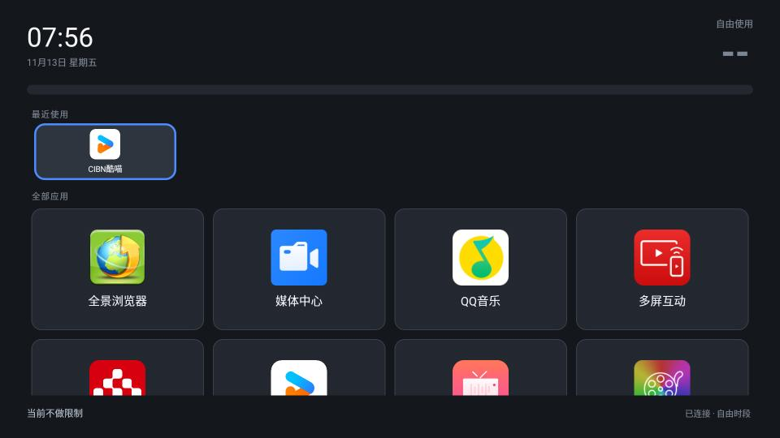
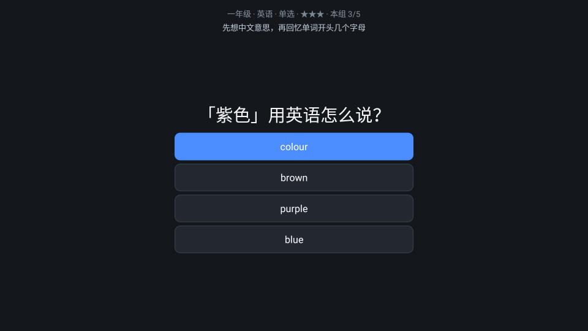
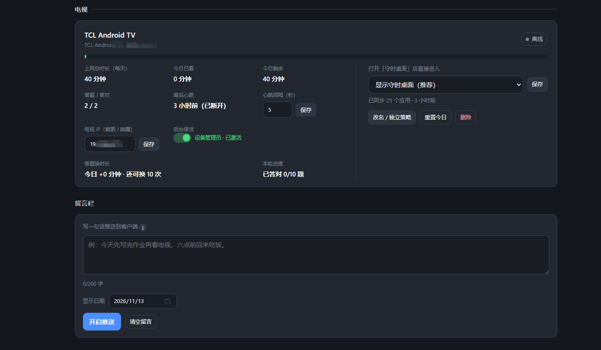
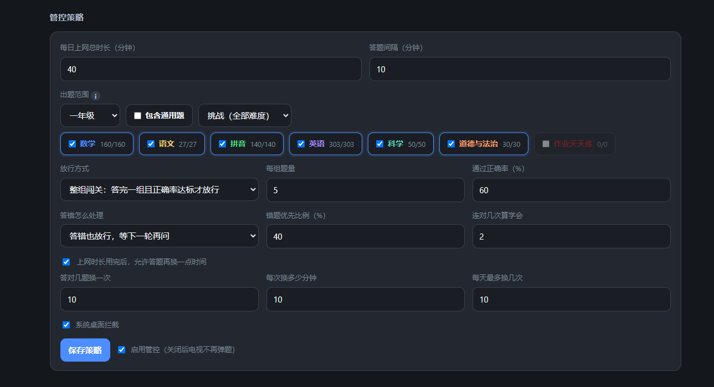

# 守时桌面（TvGuard）

本软件电视答题功能是家长管控孩子的利器，如果你家的孩子也沉迷于电视可以试试。
这不是那种装完就一键锁死的家长控制 App。真正的控制点在管理端——一台常年开着的 NAS 或小主机。电视只负责执行：拿策略、记时长、到点弹题。所以管理员改规则不用碰电视，浏览器里点几下，一分钟内生效。
本软件基于2016年购买的TCL电视进行安装测试，装到电视上的具体步骤见 [实装指南](doc/实装指南.md)。











## 两半

|     | 目录        | 干什么                         |
| --- | --------- | --------------------------- |
| 电视端 | `app/`    | 桌面、计时、弹题、锁屏、保活、自升级          |
| 管理端 | `server/` | 策略、题库、判题、统计、留言、远程修复，一个浏览器后台 |

管理端是零第三方依赖的 Node 服务，数据就是几个 JSON 文件，扔进 Docker 就能跑。

## 电视上你能看到什么

- **桌面**：左边时钟日期，右边「今天还能看」倒计时和进度条，下面是最近使用 + 全部应用。局域网的电视盒子也能跑，不要求 leanback 特性。
- **计时**：应用在前台的计时器。
- **弹题**：到间隔弹一道，单选 / 判断 / 多选都有。答对继续，答错换一道。
- **用完**：额度见底进锁定页。开了「答题换时长」就有按钮，答对 N 题换几分钟；没开就一直锁到第二天 0 点。
- **家长验证**：想回系统桌面、想退出、想改连接设置，都要输管理端那个密码。键盘是自绘的，不指望电视系统输入法。验过之后还给你 15 秒选「去系统桌面还是回去」，免得每次都要重来一遍。
- **保活向导**：设备管理员、电池白名单、安全软件、屏蔽厂商清理工具，逐项告诉你是开是关。低端盒子杀后台是常态，这一步跳过，前面全白搭。
- **自升级**：管理端传了新 APK，电视回桌面时自己发现、下载、拉起安装器，遥控器点一下「安装」就完事。
- **家长留言**：后台写一句话，电视上以浮层显示，孩子点「知道了」才消失。
- **连接设置**：桌面底部一个入口，能看当前连的是谁、测连通、改地址、恢复出厂地址。打包时没预置地址也能在这里补。

## 管理端能做什么

策略、题库、统计三块是主干，剩下是配套：

- **管控策略**：每日额度、答题间隔、单题还是整组（整组要正确率）、难度、出哪几科、是否开放答题换时长。还能给某台电视单独覆盖一套，不用全家统一。
- **可用时段**：7 天 × 48 格，半小时一格。两种用法差别很大——「仅时段内需要答题」适合白天老人正常看、晚上管孩子；「仅时段内可用」就是到点直接锁。
- **题库**：数学是算出来的，题量无限；语文 / 拼音 / 英语是预置题库，也能自己加、批量导入、导出。每题可配提示和解析。
- **判题在服务端**：下发题目时不带答案，孩子提交了才回正确答案。前端抓包也抄不到。
- **错题本**：答错的题自动收进来，按学科筛，能一键移出。
- **观看统计**：今日已看、剩余、答题数、正确率。只按天算，没有周报月报。
- **留言栏**：写一句话推到电视浮层上。
- **电视画面**：点一下就截一张，也能开自动（10 秒一张，只留最近 5 分钟）。1080p 的 PNG 拉回来在服务端压成 JPEG，省磁盘也省流量。
- **运行日志**：注册、出题、答题、导入都记，按天导出或删掉。
- **电视版本**：后台直接传 APK 发布，包名和版本号自动读，保留 3 个历史版本，能切回旧的。
- **服务端自升级**：后台传 zip，自己解包、备份、覆盖、重启。搞坏了还能回滚到上一版。
- **保活自动修复**：电视说「无障碍没开 / 管理员没激活」，管理端直接通过电视的调试口（adb 5555）远程修，不用再开电脑敲命令。设备卡上有「立即修复」，带 15 分钟冷却。

## 两件必须先想清楚的事

### 管控有强弱之分，别含糊

| 强度  | 条件     | 实际效果                       |
| --- | ------ | -------------------------- |
| 强   | 有悬浮窗权限 | 看视频看一半也能弹题，随时拦             |
| 弱   | 只有桌面身份 | 只在他按主页回桌面时拦；赖在视频 App 里就拦不住 |

原因很实在：Android 10 以后禁止后台启动界面，唯一豁免是拿到「显示在其他应用上层」。没有这个权限，弹题的代码会被系统静默丢掉，只能记个标记等他回桌面再补。桌面底部会实时显示当前强度，弱的时候给开启入口。

### 连不上管理端就完全放行

这是产品定的规矩，不是 bug：宁可漏管，也别让孩子因为服务器挂了被卡在答题页上。

代价是**地址配错不会报错**。电视照常用，计时、弹题、拦截全部悄悄停下。发现「装好了却管不住」，先去看连接设置页的地址和连通状态，别急着怀疑权限。

## 开始用

### 一、起管理端

把 `server/` 里的 `Dockerfile`、`docker-compose.yml`、`package.json`、`src/`、`public/` 放进同一个目录，平铺，别多套一层。然后改 `docker-compose.yml` 里的登录密码：

```yaml
ADMIN_PASSWORD: "ChangeMe_2026"   # 改成你自己的
```

```bash
docker compose up -d
```

浏览器打开 `http://<宿主机局域网 IP>:8088`。首次会拉一次 `node:20-alpine`，几十兆，拉不动就配个镜像加速。

compose 用的是 `network_mode: host`，不是随便选的：默认 bridge 下容器出不到电视的 5555 端口，截图和远程修复会超时；外部请求的源 IP 又会被 NAT 成网关地址，被误当成电视 IP。改完网络必须重建容器（`docker compose up -d --force-recreate`），只重启不生效。

Windows 上的 Docker Desktop 对 host 网络支持有限，纯管理功能没事，截图和 adb 修复建议放 Linux 宿主机。

### 二、配客户端

根目录 `gradle.properties` 里两个值：

```properties
tvguard.appId=cn.binguoguo.tvguard
tvguard.serverUrl=http://192.168.1.10:8088
```

`tvguard.appId` 是包名，`tvguard.serverUrl` 是管理端地址。后者填**管理端宿主机的局域网 IP**，端口跟 compose 里的 `PORT` 一致。别填 `127.0.0.1`（那是电视自己）、别填容器内网 `172.x`、也别填公网地址。

**为什么地址要预置**：电视上没有输网址的界面，遥控器敲 URL 不现实；mDNS / UDP 广播在国内电视 ROM 上又常被裁掉，做自动发现要额外权限和常驻服务，不划算。所以出厂就得知道管理端在哪。

**不想预置也行**：这行可以留空，甚至整行删掉。这样打出来的 APK 不带地址，装到电视后桌面底部会亮起「设置管理端地址」，点进去填一次，值存在电视本地，重启不丢。同一份 APK 装到不同网段，或者公开分发给别人用，走这条路更合适。

临时换地址不用重新编译：

```bash
./gradlew assembleDebug -Ptvguard.serverUrl=http://192.168.50.5:8088
```

### 三、打包装电视

需要 JDK 17 和 Android SDK 34。

```bash
./gradlew assembleDebug
```

产物在 `app/build/outputs/apk/debug/app-debug.apk`。U 盘拷过去用电视文件管理器装，或者 `adb install -r`。

装完还有三步，一个都别省：

1. **设为默认桌面**：设置 → 桌面 / 主屏幕 → 选「守时桌面」。
2. **开悬浮窗权限**：这是强管控的开关。找不到入口就从桌面底部的保活向导里跳。
3. **跑一遍保活向导**：设备管理员、电池白名单、安全软件，能开的都开。

如果打包时没写地址，记得再点一次「设置管理端地址」。

## 目录

```
app/src/main/java/cn/binguoguo/tvguard/
├── TvGuardApp.kt        入口，初始化配置与计时引擎
├── launcher/            桌面、应用网格、应用列表
├── guard/               计时、弹题调度、保活、家长验证、自升级
├── quiz/                答题页、锁定页、离线口算题库
├── diag/                设备诊断 + 管理端连接设置
├── net/                 与管理端通信
└── data/                配置、进度、应用仓库

server/
├── src/app.js           路由与业务主干
├── src/quiz.js          出题 / 判题 / 导入导出
├── src/subjects.js      学科定义与预置题库
├── src/store.js         数据持久化
├── src/adb.js           零依赖 ADB over TCP（远程修复用）
├── src/screenshot.js    截屏
├── src/img.js           PNG 解码 + JPEG 编码
├── src/apk.js           电视端 APK 解析与分发
├── public/              管理网页
└── data/                运行时生成
```

## 许可

代码按 MIT 开源，见 `LICENSE`。第三方题库数据和构建依赖各有自己的许可，其中那份 CC BY-NC 4.0 的题库数据不能商用，动手前先看 `THIRD_PARTY.md`。
